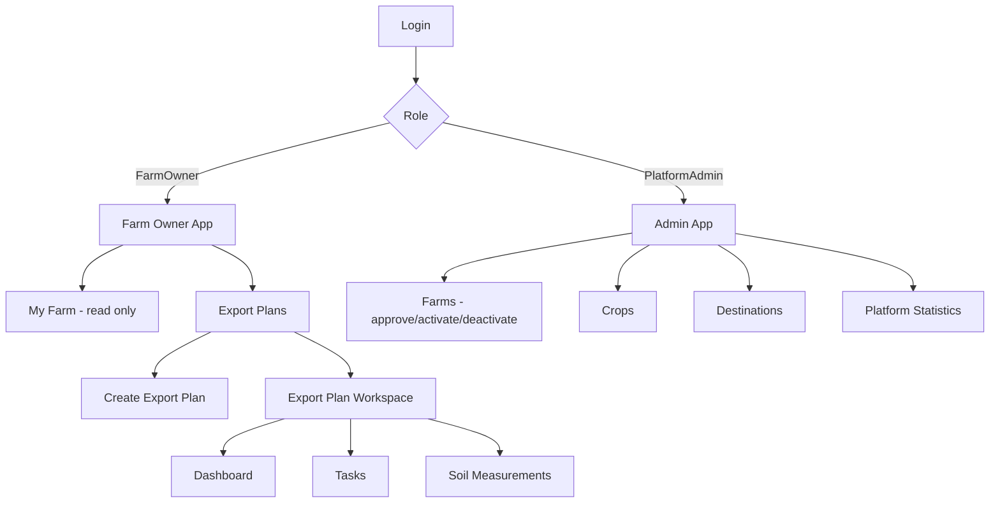
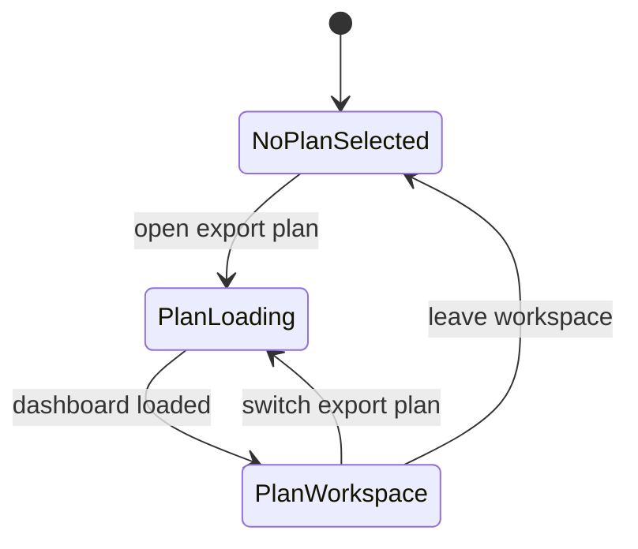
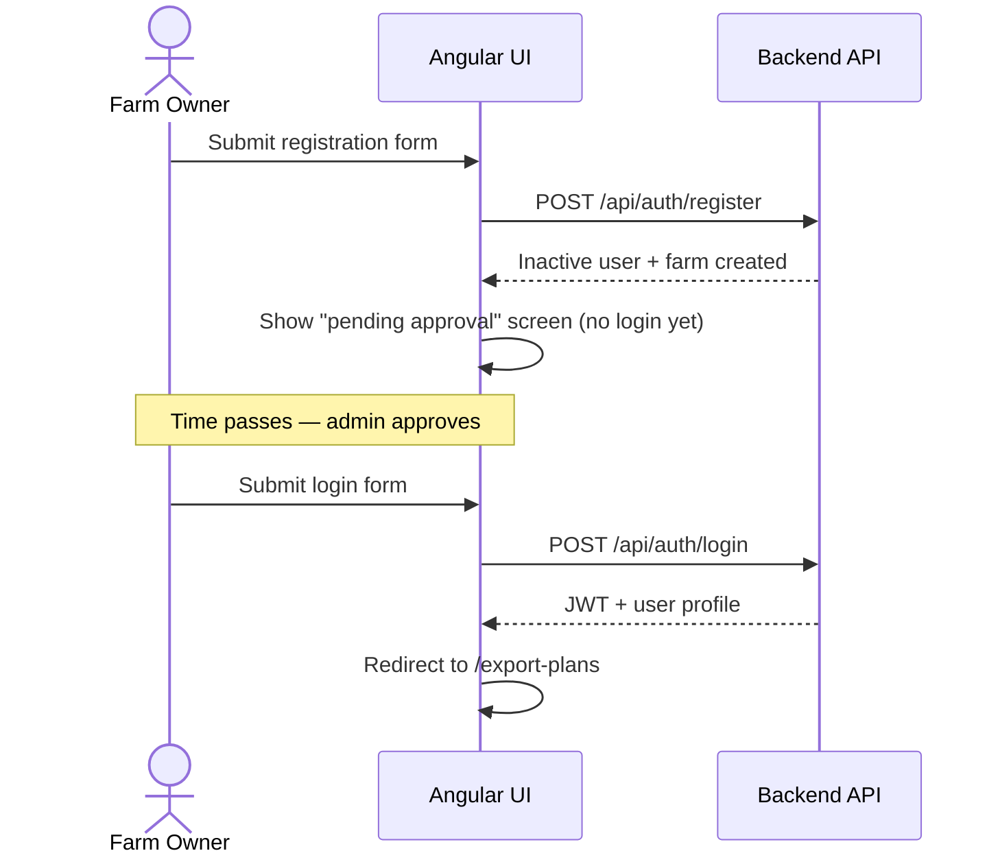
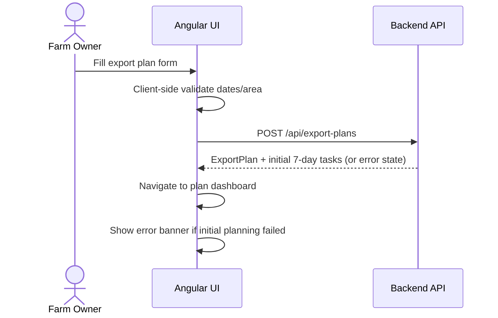
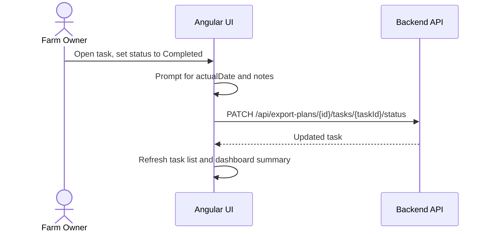
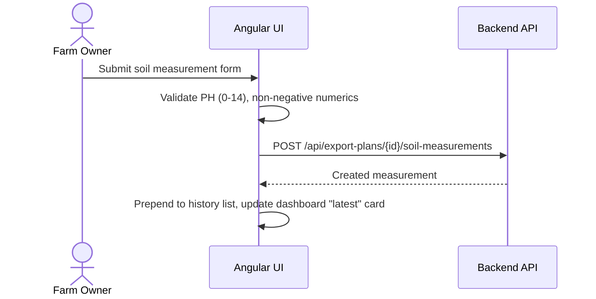
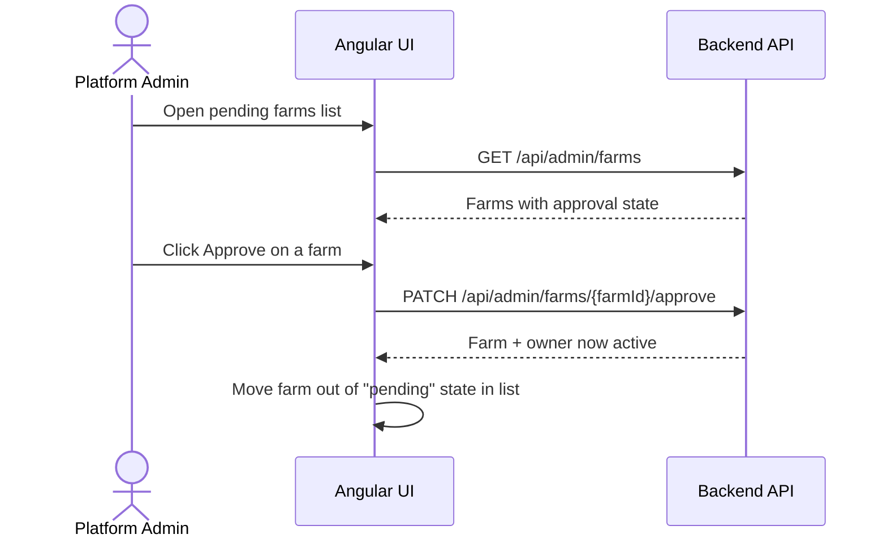

# GreenMind Frontend Software Requirements Specification — Phase 1

**Version:** 1.0
**Date:** 2026-07-19
**Scope:** Phase 1 only — must mirror the approved Phase 1 Backend SRS and ERD exactly. No Phase 2 features.
**Platform:** Angular, Arabic RTL
**Backend:** ASP.NET Core 10 REST API (JWT-based)
**Related Documents:** `GreenMind_Phase1_SRS.md` (backend), `GreenMind – Phase 1 ERD`

---

## 1. Purpose

This document defines the frontend requirements for GreenMind Phase 1. The frontend is an Angular, Arabic RTL application that allows a **Farm Owner** to create export-oriented agricultural season plans (`ExportPlan`), view an automatically generated rolling 7-day task plan, record soil measurements, and monitor season progress via a per-plan dashboard. A **Platform Admin** uses the frontend to approve farm registrations, manage farms/crops/destinations master data, and view platform statistics.

This document is scoped strictly to what the Phase 1 backend SRS supports. It must not introduce screens, routes, or components for features the backend does not implement in Phase 1 (AI chat, disease detection, compliance engine, reports, notifications, manual task management, timeline editing).

---

## 2. Users and Roles

### 2.1 Platform Admin

- Reviews and approves pending farm registrations.
- Activates/deactivates farm accounts.
- Manages crops and destinations master data.
- Views platform statistics.

### 2.2 Farm Owner

- Registers a farm account (awaits admin approval before first login).
- Logs in once active.
- Views their own farm account (read-only in Phase 1 — no farm profile editing endpoint exists).
- Creates export plans for their own farm.
- Views their own export plans and per-plan dashboard.
- Views tasks generated for a plan and updates task **status, actual date, and notes only**.
- Performs full CRUD on soil measurements for their own export plans.

**Access rule:** A Farm Owner can access only data under their own farm. The frontend must never let the user select or override a `farmId` — it is always inferred server-side from the JWT.

---

## 3. Phase 1 Scope

### 3.1 Included

- Arabic RTL interface, end to end.
- Farm Owner registration (pending-approval state), login, logout.
- Platform Admin: farm approval/activation/deactivation, crop management, destination management, platform statistics.
- Export plan creation (Strawberry / EU / Saudi Arabia at seed time, but the crop/destination dropdowns must be data-driven from `/api/crops` and `/api/destinations`, not hardcoded).
- Export plan list and read-only detail view.
- Automatic Planning Agent execution on plan creation (no manual "Generate" button, no loading state that implies user-triggered generation — see §6.6).
- Export plan dashboard (season day, progress, growth stage, latest soil reading, task summary, upcoming/completed tasks).
- Task list, filtering, and status update (status, actual date, notes) — **view + execution-update only**.
- Soil measurement CRUD per export plan.
- Route guards enforcing role-based access.

### 3.2 Explicitly Excluded (must not be built in Phase 1)

Matching the backend's "Out of Scope" section exactly:

- AI chat / any chat UI.
- Disease detection / image upload for crop diagnosis.
- Compliance engine, compliance badges, or compliance findings.
- Reports generation or downloads.
- Notifications center (email/WhatsApp).
- Manual task creation, task editing (title/description/date/type/priority), task deletion.
- A "regenerate timeline" or "generate plan" button of any kind.
- Multi-tenant / SuperAdmin tenant management screens (Phase 1 only has Platform Admin managing farms, not "tenants" as a separate concept).
- Farm profile editing (no update endpoint exists for Farm in Phase 1 — Farm Owner view is read-only).
- Any crop other than what is returned by `/api/crops`, and any destination other than what is returned by `/api/destinations` — the UI must not hardcode "Strawberry" or country names as static options.

---

## 4. UX Principles

- The interface shall be fully Arabic and RTL.
- The **export plan is the primary workspace**, exactly as the backend hierarchy dictates: `Farm → ExportPlans → Tasks / SoilMeasurements`. Navigation must always make clear which export plan is active.
- Task status changes are the only write action a Farm Owner can perform on a task. The UI must not present affordances (buttons, drag-drop, inline edit) that imply task creation, editing of generated fields, deletion, or regeneration — because the backend will reject all of these.
- `CurrentSeasonDay` and all dashboard-calculated values are read-only, backend-calculated fields. The frontend must never compute or override them locally; it only displays what `/dashboard` returns.
- Registration does not equal access. The UI must clearly communicate the "pending admin approval" state after registration and must not imply the user can log in immediately.

---

## 5. Information Architecture



---

## 6. Main Screens

### 6.1 Authentication

**Screens:** Register, Login.

Requirements:

- Register form fields: `fullName`, `email`, `password`, `farmName` — matching `POST /api/auth/register` exactly.
- On successful registration, show an Arabic confirmation state: *"تم إرسال طلب التسجيل، بانتظار موافقة الإدارة"* (registration is pending admin approval) — no auto-login, no redirect to dashboard.
- Login form: `email`, `password`. On success, store JWT and redirect by role (`GET /api/auth/me` or the login response's `user.role`):
  - `FarmOwner` → `/export-plans`
  - `PlatformAdmin` → `/admin/farms`
- Login failure due to inactive user must show a specific Arabic message distinguishing "not yet approved" from "invalid credentials," if the API differentiates via `errorCode`.
- Logout clears the stored JWT client-side and calls `POST /api/auth/logout` for audit purposes.

### 6.2 My Farm (Farm Owner)

Read-only view of the Farm Owner's own farm:

- Farm name.
- Created date.
- Owner name/email (from `/api/auth/me`).

No edit or delete actions — there is no such endpoint in Phase 1.

### 6.3 Export Plans List

Route: `/export-plans`. Calls `GET /api/export-plans`.

Table/card columns:

- Plan name.
- Crop.
- Destination.
- Planting date, expected harvest date, expected export date.
- Status (`Draft`, `Active`, `Completed`, `Cancelled`).

Actions:

- Create export plan.
- Open plan (goes to `/export-plans/:exportPlanId` dashboard).

If a plan's status is `Draft` because initial task generation failed (per FR-AI-010), the list and the plan itself must surface this clearly (e.g., a status badge "لم يتم إنشاء المهام الأولية" / "initial tasks could not be generated") rather than silently showing an empty task list.

### 6.4 Create Export Plan

Route: `/export-plans/new`. Calls `POST /api/export-plans`.

Fields (exact match to backend contract):

| Field | Source |
|---|---|
| `name` | text input |
| `cropId` | dropdown populated from `GET /api/crops` |
| `destinationId` | dropdown populated from `GET /api/destinations` |
| `governorate` | text input |
| `city` | text input |
| `latitude`, `longitude` | numeric inputs or map picker |
| `areaInFeddan` | numeric input, must be > 0 |
| `plantingDate` | Arabic-friendly date picker |
| `expectedHarvestDate` | date picker, must be after `plantingDate` |
| `expectedExportDate` | date picker, must be on/after `expectedHarvestDate` |
| `notes` | optional textarea |

Client-side validation must mirror backend validation (§20.2 of backend SRS) so users get instant Arabic feedback, but the backend response remains the source of truth.

On submit:

- Show a loading state indicating the plan is being saved and the first week of tasks is being prepared (do **not** phrase this as "generating your plan," since there is no user-facing "AI planning" concept to promote — keep it factual: "جارٍ حفظ الخطة وتجهيز مهام الأسبوع الأول").
- On success, navigate directly to the plan dashboard.
- On failure where the plan was saved but initial planning failed (FR-AI-010 / FR-PLAN error state), still navigate to the dashboard but show a clear inline error banner that initial tasks could not be generated, with no retry/regenerate button (not supported in Phase 1).

### 6.5 Export Plan Workspace

Persistent header while inside a plan, showing: plan name, crop, destination, status, current season day.

Tabs:

- Dashboard
- Tasks
- Soil Measurements

### 6.6 Dashboard Tab

Route: `/export-plans/:exportPlanId`. Calls `GET /api/export-plans/{exportPlanId}/dashboard`.

Displays (per FR-DASH-001 to 009), all backend-calculated, read-only:

- Crop and destination.
- Current season day.
- Season progress (e.g., a progress bar).
- Current growth stage.
- Latest soil measurement snapshot.
- Task summary (counts by status).
- Upcoming tasks (short list, links into Tasks tab).
- Completed tasks (short list, links into Tasks tab).

There must be **no button on this tab to generate, regenerate, or refresh the plan** — the rolling 7-day horizon is maintained automatically by a daily backend job (FR-AI-011 to FR-AI-017), invisible to the user.

### 6.7 Tasks Tab

Route: `/export-plans/:exportPlanId/tasks`. Calls `GET /api/export-plans/{exportPlanId}/tasks`.

Displays:

- Task list with title, description, task type, planned date, actual date, status, priority, notes.

Filters (per FR-TASK-009):

- Status.
- Priority.
- Task type.
- Planned date range.

Actions:

- **Update status only**, via `PATCH /api/export-plans/{exportPlanId}/tasks/{taskId}/status`, with payload `{ status, actualDate, notes }`.
- Marking a task `Completed` should prompt for `actualDate` (defaulting to today) and optional notes.

The UI must not render any control to create a task, edit `title`/`description`/`plannedDate`/`taskType`/`priority`, or delete a task — these fields are display-only, enforced by disabling/hiding inputs, not merely by relying on backend rejection.

### 6.8 Soil Measurements Tab

Route: `/export-plans/:exportPlanId/soil-measurements`.

Full CRUD, matching `/api/export-plans/{exportPlanId}/soil-measurements` endpoints:

- List history (`GET`), most recent first.
- Add new measurement (`POST`): `measurementDate`, `ph` (0–14), `ec`, `nitrogen`, `phosphorus`, `potassium`, `moisture` (all ≥ 0), `notes`.
- Edit measurement (`PUT`).
- Delete measurement (`DELETE`), with a confirmation dialog.

No AI-generated recommendations are shown here (FR-SOIL-007) — this tab is a pure data log.

### 6.9 Admin: Farms

Route: `/admin/farms`. Calls `GET /api/admin/farms`.

Displays: farm name, owner, created date, active/inactive state, approval state.

Actions:

- Approve (`PATCH /api/admin/farms/{farmId}/approve`) — only shown for pending farms.
- Activate / Deactivate (`PATCH .../activate`, `PATCH .../deactivate`).
- Open farm detail (`GET /api/admin/farms/{farmId}`).

### 6.10 Admin: Crops

Route: `/admin/crops`.

- List active/inactive crops (`GET /api/crops` shows active only to Farm Owners; admin view should show all via an admin-scoped list if the backend exposes it, otherwise reuse `/api/crops` and layer create/update/deactivate actions).
- Create (`POST /api/admin/crops`), update (`PUT /api/admin/crops/{cropId}`), deactivate (`PATCH /api/admin/crops/{cropId}/deactivate`).

### 6.11 Admin: Destinations

Route: `/admin/destinations`. Same pattern as Crops, against `/api/admin/destinations` endpoints.

### 6.12 Admin: Platform Statistics

Route: `/admin/statistics`. Calls `GET /api/admin/statistics`.

Displays (FR-STAT-001 to 004): total farms, active/inactive farm counts, total export plans, export plans grouped by crop and by destination.

---

## 7. Frontend Routes

| Route | Screen | Role |
|---|---|---|
| `/auth/register` | Register | Public |
| `/auth/login` | Login | Public |
| `/farm` | My Farm (read-only) | FarmOwner |
| `/export-plans` | Export plans list | FarmOwner |
| `/export-plans/new` | Create export plan | FarmOwner |
| `/export-plans/:exportPlanId` | Plan dashboard | FarmOwner |
| `/export-plans/:exportPlanId/tasks` | Tasks | FarmOwner |
| `/export-plans/:exportPlanId/soil-measurements` | Soil measurements | FarmOwner |
| `/admin/farms` | Farm approval/management | PlatformAdmin |
| `/admin/farms/:farmId` | Farm detail | PlatformAdmin |
| `/admin/crops` | Crop management | PlatformAdmin |
| `/admin/destinations` | Destination management | PlatformAdmin |
| `/admin/statistics` | Platform statistics | PlatformAdmin |

Route guards must block a `FarmOwner` from any `/admin/*` route and a `PlatformAdmin` from any `/export-plans/*` or `/farm` route (Platform Admin has no farm of their own).

---

## 8. Component Requirements

Suggested Angular structure (mirrors backend's suggested frontend layout in §19.2 of the backend SRS):

```text
src/app/
  core/
    auth/            # token storage, current-user state
    guards/          # role guards, auth guard
    interceptors/     # JWT attach, 401 handling
    services/
  shared/
    components/
      SeasonDayBadge
      GrowthStageBadge
      TaskStatusBadge
      TaskPriorityBadge
      ExportPlanStatusBadge
      ArabicDatePicker
      SoilMeasurementForm
      TaskFilterBar
    models/          # ExportPlan, Task, SoilMeasurement, Farm, Crop, Destination DTOs
    validators/       # date-range, numeric-range validators mirroring backend rules
  features/
    auth/
      register/
      login/
    farm/
    export-plans/
      plan-list/
      plan-create/
      plan-dashboard/
      tasks/
      soil-measurements/
    admin/
      farms/
      crops/
      destinations/
      statistics/
  layout/
    farm-owner-layout/
    admin-layout/
```

---

## 9. API Integration Requirements

Typed API services, one per backend area, each method mapped 1:1 to the endpoint table in the backend SRS §12:

- `AuthApiService`: `register`, `login`, `logout`, `getCurrentUser`.
- `AdminFarmApiService`: `listFarms`, `getFarm`, `approveFarm`, `activateFarm`, `deactivateFarm`.
- `CropApiService`: `listActiveCrops`; `AdminCropApiService`: `createCrop`, `updateCrop`, `deactivateCrop`.
- `DestinationApiService`: `listActiveDestinations`; `AdminDestinationApiService`: `createDestination`, `updateDestination`, `deactivateDestination`.
- `FarmApiService`: `getMyFarm`.
- `ExportPlanApiService`: `list`, `create`, `getById`, `getDashboard`.
- `TaskApiService`: `list(exportPlanId, filters)`, `getById(exportPlanId, taskId)`, `updateStatus(exportPlanId, taskId, payload)`.
- `SoilMeasurementApiService`: `list`, `create`, `getById`, `update`, `delete` — all scoped by `exportPlanId`.
- `AdminStatisticsApiService`: `getStatistics`.

All export-plan-scoped and task/soil-measurement-scoped methods must require `exportPlanId` as an explicit parameter — never inferred from component state alone — so ownership context travels with every call.

Example:

```ts
updateTaskStatus(
  exportPlanId: string,
  taskId: string,
  payload: { status: TaskStatus; actualDate?: string; notes?: string }
): Observable<Task>
```

An HTTP interceptor attaches the JWT to every request and redirects to `/auth/login` on a 401 response, clearing stored auth state.

---

## 10. Frontend State Management

State shall preserve:

- Authenticated user and role.
- Current export plan summary (name, crop, destination, status, current season day) while inside a plan workspace.
- Task list filters for the currently open plan.

The frontend must clear plan-specific state (loaded tasks, soil measurements, filters) when the user switches to a different export plan or leaves the workspace — there is no cross-plan chat state to manage in Phase 1, but stale task/soil data must not leak between plans.



---

## 11. Critical User Flows

### 11.1 Register → Pending Approval → Login



### 11.2 Create Export Plan (Automatic Initial Planning)



### 11.3 Update Task Status



### 11.4 Soil Measurement CRUD



### 11.5 Admin Approves Farm



---

## 12. Validation and Error States

Mirroring backend validation (§20 of backend SRS) so the user gets immediate Arabic feedback before any request is sent:

- Required fields on registration and export plan forms.
- `expectedHarvestDate` must be after `plantingDate`; `expectedExportDate` must be on/after `expectedHarvestDate`.
- `areaInFeddan` > 0; latitude/longitude within valid geographic ranges.
- Soil measurement: PH between 0 and 14; EC/nitrogen/phosphorus/potassium/moisture ≥ 0.
- Task status must be one of the supported enum values; `actualDate` required when marking `Completed`.

The UI must also handle, with actionable Arabic messages:

- Login attempt by an inactive/unapproved user (distinct message from wrong credentials, where the API differentiates).
- Unauthorized tenant access (403) — redirect to a generic "access denied" state, never expose another farm's data even transiently.
- Export plan created but initial task generation failed (Draft status with error state).
- Network/API timeout on any request.
- Duplicate email on registration (409/validation error).
- Attempting to approve an already-approved farm (409).

---

## 13. Accessibility and Localization

- Full RTL layout across every screen.
- Arabic labels, menus, validation messages, empty states, and error messages.
- Dates displayed in an Arabic-friendly format via the shared `ArabicDatePicker`.
- Keyboard navigation for all forms (registration, export plan creation, soil measurement, task status update).
- Sufficient contrast for status/priority badges; never rely on color alone to distinguish task status, priority, or plan status — pair color with text/icon.

---

## 14. Non-Functional Requirements

- Export plan dashboard should target initial load under 2 seconds on normal broadband.
- Route guards must prevent Farm Owners from reaching `/admin/*` and Platform Admins from reaching Farm Owner routes, enforced client-side in addition to backend authorization.
- Responsive for desktop and tablet; mobile should keep core flows (login, dashboard, task status update) usable.
- Task status updates and soil measurement submissions must show a loading state and prevent duplicate submits (double-click protection).
- The frontend must not store secrets; the JWT is the only credential held client-side, and it must be handled per the frontend security policy (e.g., not logged, not exposed in URLs).
- No client-side computation may substitute for backend-calculated values (`CurrentSeasonDay`, season progress, growth stage) — these are always fetched, never derived locally.

---

## 15. Acceptance Criteria

- Arabic RTL layout renders correctly across all screens.
- Farm Owner can register and sees a clear "pending approval" state, with no ability to log in before admin approval.
- Farm Owner can log in once approved and is redirected to the export plans list.
- Farm Owner can create an export plan for their own farm using crop/destination options loaded from the API (not hardcoded).
- After creation, the UI shows the dashboard with the automatically generated first 7 days of tasks, without any manual "generate" action existing anywhere in the UI.
- If initial task generation fails, the plan still appears with a clear error state, and no regenerate button is offered.
- Farm Owner can view and filter tasks, and can update only status/actual date/notes — no create, edit-core-fields, or delete controls exist for tasks anywhere in the UI.
- Farm Owner can fully manage (create/update/delete/view) soil measurements for their own export plans.
- Dashboard displays crop, destination, current season day, progress, growth stage, latest soil measurement, task summary, upcoming tasks, and completed tasks — all sourced from the backend, never computed client-side.
- Farm Owner cannot access another farm's plans, tasks, or soil measurements — verified by attempting cross-farm navigation and confirming access is denied.
- Platform Admin can view and approve pending farm registrations, activate/deactivate farms, manage crops and destinations, and view platform statistics.
- Platform Admin has no access to Farm Owner routes (`/export-plans`, `/farm`) and vice versa.
- No screen, route, component, or button exists in the frontend for: AI chat, disease detection, compliance findings, reports, notifications, manual task creation/edit/delete, or timeline regeneration.

---

## 16. Out of Scope (Frontend)

Consistent with the backend SRS §24, the frontend must not implement:

- Chat UI of any kind.
- Image upload / disease detection UI.
- Compliance badges, findings, or compliance-related screens.
- Report generation/download screens.
- Notification center or notification preference screens.
- Manual task creation/editing/deletion UI, or a timeline regeneration control.
- Farm profile editing forms (no backend support exists).
- SuperAdmin/tenant-management concepts beyond what Platform Admin's farm/crop/destination/statistics screens already cover.

---

## 17. Future Scope (Not Phase 1)

Per the backend SRS §25, later phases may introduce AI chat, compliance engine, disease detection, reports, notifications, and full manual task management/timeline editing. These are explicitly excluded from this document and must not be scaffolded, stubbed, or left as placeholder routes in the Phase 1 frontend codebase.
