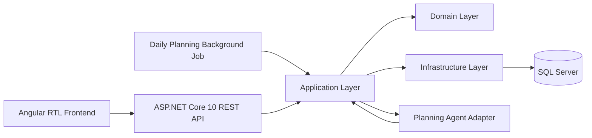
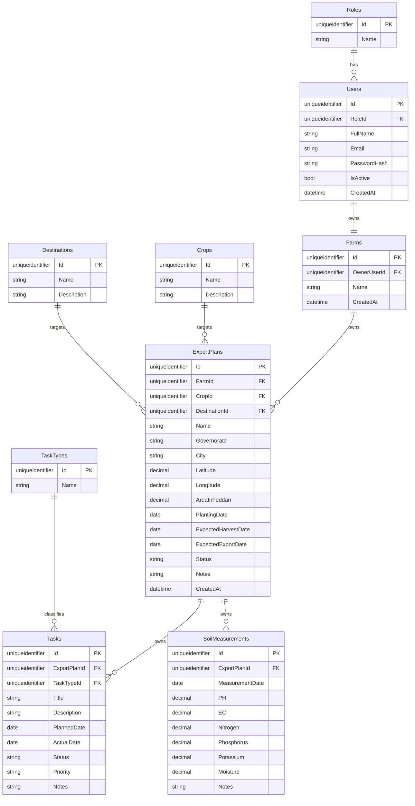
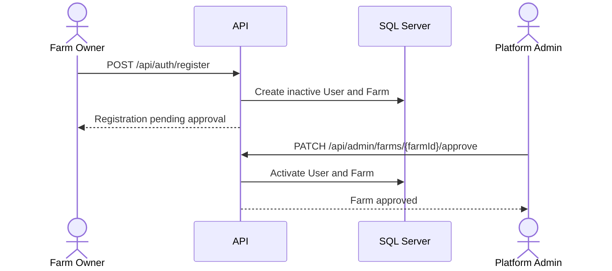
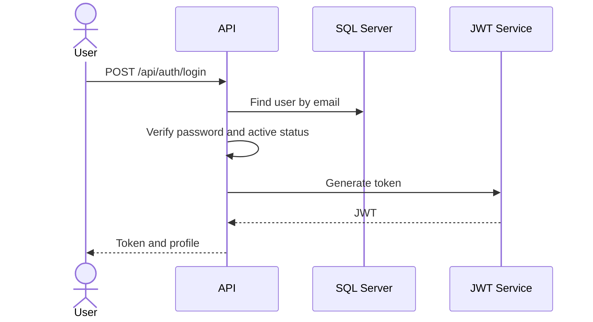
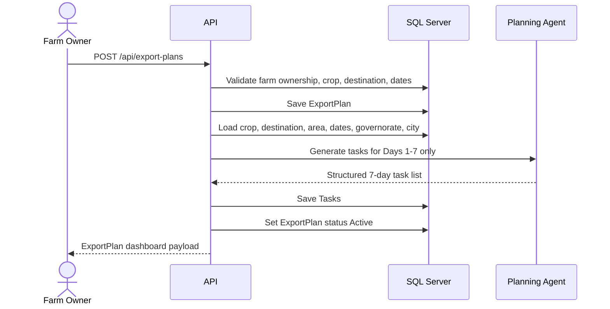
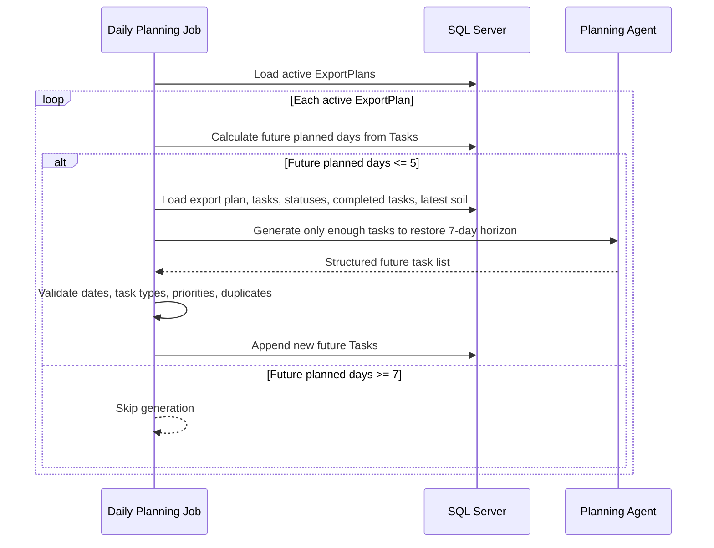
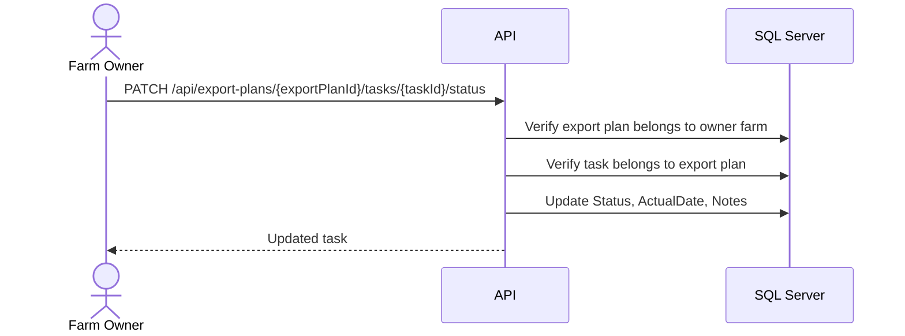
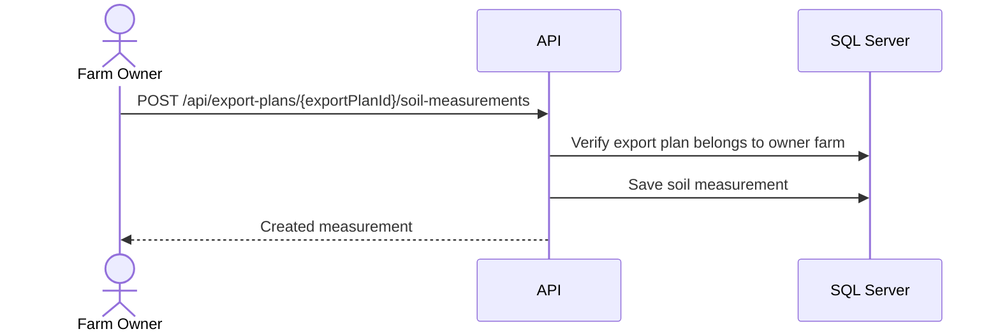

# GreenMind Phase 1 Software Requirements Specification

**Version:** 1.0  
**Date:** 2026-07-19  
**Scope:** Phase 1 only  
**Backend Platform:** ASP.NET Core 10 REST API  
**Frontend Platform:** Angular with Arabic RTL support  
**Database:** SQL Server  
**AI Scope:** Stateless Planning Agent with rolling 7-day task generation

---

## 1. Purpose

This Software Requirements Specification defines the complete Phase 1 requirements for GreenMind.

GreenMind Phase 1 is a SaaS platform that helps farm owners create export-oriented agricultural season plans, automatically maintain a rolling 7-day farming task plan, record soil measurements, and monitor season progress through export plan dashboards.

The document is intended to be implementation-ready for a development team of seven developers working for one month.

---

## 2. Phase 1 Scope

Phase 1 includes only the core business workflow:

- Farm account registration and platform admin approval.
- JWT-based login and logout.
- Role-based authorization for Platform Admin and Farm Owner.
- Farm account management as a SaaS tenant.
- Crop and destination master data management.
- Export plan creation and viewing.
- Automatic execution of one Planning Agent after export plan creation to create the first 7 days of tasks.
- Daily background planning that appends future tasks when the rolling horizon drops to 5 future planned days.
- Task viewing, status updates, completion, actual date, and notes.
- Soil measurement CRUD per export plan.
- Export plan dashboard with calculated season information.

Phase 1 does not include compliance evaluation, RAG, chat, disease detection, notifications, reports, image processing, multi-agent orchestration, manual timeline editing, manual task creation, or timeline regeneration.

---

## 3. Business Context

GreenMind helps farms manage export-oriented agricultural seasons. In Phase 1, the system focuses on creating one agricultural season as an `ExportPlan`, maintaining a rolling 7-day task plan for that export plan, and tracking basic execution and soil history.

The core business hierarchy is:

```text
Farm Account
  -> Export Plans
      -> Tasks
      -> Soil Measurements
```

Each export plan represents one agricultural season for one crop targeting one export destination. Each export plan is isolated from every other export plan.

---

## 4. Definitions

| Term | Definition |
|---|---|
| Farm Account | The SaaS tenant/customer account. It is not a physical farm. |
| Farm Owner | Tenant user who owns one farm account and can manage only that account's data. |
| Platform Admin | System-level administrator responsible for approvals and master data. |
| Export Plan | One agricultural season for one crop and one export destination. |
| Planning Agent | The only AI component in Phase 1. It is stateless and appends tasks to maintain a rolling 7-day planning horizon. |
| Task | A planned agricultural action generated by the Planning Agent. |
| Soil Measurement | A soil reading recorded under one export plan. |
| Current Season Day | Dynamic value calculated from the export plan planting date. It is not stored. |

---

## 5. User Roles and Permissions

### 5.1 Platform Admin

The Platform Admin is responsible for platform-level operations.

Permissions:

- View farm registrations.
- Approve farm registrations.
- Activate or deactivate farm accounts.
- Manage farm accounts.
- Manage crops.
- Manage export destinations.
- View platform statistics.

### 5.2 Farm Owner

The Farm Owner represents one SaaS tenant.

Permissions:

- Register a farm account.
- Login after admin approval.
- View own farm account.
- Create export plans for own farm.
- View own export plans.
- View tasks generated for own export plans.
- Update task status, actual date, and execution notes.
- Create, update, delete, and view soil measurements for own export plans.
- View dashboards for own export plans.

Access rules:

- A Farm Owner can access only their own data.
- A Farm Owner owns exactly one farm account.
- A Farm Owner cannot access another farm owner's farm, export plans, tasks, or soil measurements.
- A Farm Owner cannot create, edit, delete, or regenerate tasks in Phase 1.

---

## 6. System Overview

### 6.1 High-Level Architecture



### 6.2 Clean Architecture Layers

| Layer | Responsibility |
|---|---|
| API | Controllers, authentication middleware, authorization policies, request/response DTOs, OpenAPI documentation. |
| Application | Use cases, validation, orchestration, transaction boundaries, rolling horizon calculation, Planning Agent invocation. |
| Domain | Entities, enums, domain rules, tenant isolation rules, calculated season values. |
| Infrastructure | Entity Framework Core, SQL Server repositories, JWT token service, password hashing, AI provider adapter, daily background job, seed data. |
| Frontend | Angular UI, Arabic RTL layout, route guards, API clients, feature modules, form validation. |

### 6.3 Architectural Constraints

- The fixed database schema in this document must not be redesigned.
- No Phase 2 entities may be added.
- `CurrentSeasonDay` must be calculated dynamically from `PlantingDate`.
- Tasks must be generated automatically by the Planning Agent using a rolling 7-day planning horizon.
- Export plan creation generates only the first 7 days of tasks.
- A daily background job checks active export plans and appends tasks when the rolling horizon drops to 5 future planned days, restoring it to 7 future planned days.
- The Planning Agent must be stateless and rely only on export plan data, current database state, task history, task statuses, and latest soil measurements.
- The Planning Agent must never regenerate the full timeline, delete tasks, modify existing tasks, or duplicate tasks.
- Manual task creation, editing, deletion, and timeline regeneration are not supported in Phase 1.
- Every export plan must be isolated from other export plans.

---

## 7. Functional Requirements

### 7.1 Authentication and Authorization

| ID | Requirement |
|---|---|
| FR-AUTH-001 | The system shall allow a Farm Owner to submit a farm registration request. |
| FR-AUTH-002 | The system shall keep newly registered Farm Owner users inactive until Platform Admin approval. |
| FR-AUTH-003 | The system shall allow a Platform Admin to approve farm registrations. |
| FR-AUTH-004 | The system shall allow active users to login using email and password. |
| FR-AUTH-005 | The system shall issue a JWT token after successful login. |
| FR-AUTH-006 | The system shall reject login for inactive users. |
| FR-AUTH-007 | The system shall support logout on the client by removing the JWT token. |
| FR-AUTH-008 | The system shall enforce role-based authorization for Platform Admin and Farm Owner. |
| FR-AUTH-009 | The system shall prevent Farm Owners from accessing data belonging to another farm account. |

### 7.2 Farm Management

| ID | Requirement |
|---|---|
| FR-FARM-001 | The system shall represent each tenant as one `Farm` record. |
| FR-FARM-002 | The system shall create one farm account when a Farm Owner registration is approved. |
| FR-FARM-003 | The system shall allow Platform Admins to view all farms. |
| FR-FARM-004 | The system shall allow Platform Admins to activate or deactivate farms. |
| FR-FARM-005 | The system shall allow a Farm Owner to view only their own farm account. |
| FR-FARM-006 | The system shall enforce that one user owns exactly one farm. |

### 7.3 Crop Management

| ID | Requirement |
|---|---|
| FR-CROP-001 | The system shall store crops in a master table. |
| FR-CROP-002 | The system shall seed Strawberry as the supported MVP crop. |
| FR-CROP-003 | The system shall allow Platform Admins to create, update, list, and deactivate crops. |
| FR-CROP-004 | The system shall allow Farm Owners to list active crops. |

### 7.4 Destination Management

| ID | Requirement |
|---|---|
| FR-DEST-001 | The system shall store export destinations in a master table. |
| FR-DEST-002 | The system shall seed European Union and Saudi Arabia as supported MVP destinations. |
| FR-DEST-003 | The system shall allow Platform Admins to create, update, list, and deactivate destinations. |
| FR-DEST-004 | The system shall allow Farm Owners to list active destinations. |

### 7.5 Export Plan Management

| ID | Requirement |
|---|---|
| FR-PLAN-001 | The system shall allow a Farm Owner to create an export plan for their own farm. |
| FR-PLAN-002 | The system shall require crop, destination, location, area, planting date, expected harvest date, and expected export date when creating an export plan. |
| FR-PLAN-003 | The system shall validate that expected harvest date is after planting date. |
| FR-PLAN-004 | The system shall validate that expected export date is on or after expected harvest date. |
| FR-PLAN-005 | The system shall store export plan status and notes. |
| FR-PLAN-006 | The system shall allow a Farm Owner to list only their own export plans. |
| FR-PLAN-007 | The system shall allow a Farm Owner to view details for only their own export plans. |
| FR-PLAN-008 | The system shall calculate current season day dynamically from planting date. |
| FR-PLAN-009 | The system shall not store current season day in the database. |
| FR-PLAN-010 | The system shall automatically execute the Planning Agent immediately after saving a new export plan to generate only the first 7 days of tasks. |

### 7.6 Planning Agent

| ID | Requirement |
|---|---|
| FR-AI-001 | The system shall include one AI component named Planning Agent. |
| FR-AI-002 | The Planning Agent shall run automatically after export plan creation for initial planning. |
| FR-AI-003 | Initial planning shall generate only tasks for the first 7 days of the export plan. |
| FR-AI-004 | Initial planning shall use crop, destination, area, planting date, expected harvest date, expected export date, governorate, and city. |
| FR-AI-005 | The system shall persist Planning Agent output as `Tasks` in SQL Server. |
| FR-AI-006 | The system shall redirect the user to the export plan dashboard after successful initial task generation. |
| FR-AI-007 | The system shall not provide a manual generate button in Phase 1. |
| FR-AI-008 | The system shall not support timeline regeneration in Phase 1. |
| FR-AI-009 | The system shall prevent duplicate tasks during initial and continuous planning. |
| FR-AI-010 | If Planning Agent execution fails during initial planning, the system shall keep the export plan saved and return a clear error state indicating that initial tasks could not be generated. |
| FR-AI-011 | The system shall run a background planning job once every day. |
| FR-AI-012 | The daily planning job shall process each active export plan. |
| FR-AI-013 | The daily planning job shall calculate how many planned days remain for each active export plan. |
| FR-AI-014 | The daily planning job shall invoke the Planning Agent when the rolling horizon has dropped below the configured threshold and must follow the Phase 1 example: Day 2 with 6 future planned days does not generate, while Day 3 with 5 future planned days generates enough tasks to restore 7 future planned days. |
| FR-AI-015 | Continuous planning shall send export plan data, current season day, existing tasks, completed tasks, current task statuses, and latest soil measurements when available. |
| FR-AI-016 | Continuous planning shall generate only enough new tasks to restore a 7-day planning horizon. |
| FR-AI-017 | Continuous planning shall append only future tasks. |
| FR-AI-018 | The Planning Agent shall never regenerate the entire farming timeline. |
| FR-AI-019 | The Planning Agent shall never delete or modify existing tasks. |
| FR-AI-020 | The Planning Agent shall be stateless and maintain no internal memory between requests. |

### 7.7 Task Management

| ID | Requirement |
|---|---|
| FR-TASK-001 | The system shall allow Farm Owners to view tasks for their own export plans. |
| FR-TASK-002 | The system shall allow Farm Owners to update task status. |
| FR-TASK-003 | The system shall allow Farm Owners to mark a task as completed. |
| FR-TASK-004 | The system shall allow Farm Owners to set actual date when completing a task. |
| FR-TASK-005 | The system shall allow Farm Owners to add execution notes to a task. |
| FR-TASK-006 | The system shall prevent Farm Owners from creating tasks manually. |
| FR-TASK-007 | The system shall prevent Farm Owners from editing generated task title, description, planned date, type, and priority. |
| FR-TASK-008 | The system shall prevent Farm Owners from deleting tasks. |
| FR-TASK-009 | The system shall support task filtering by status, priority, task type, and planned date range. |

### 7.8 Soil Measurements

| ID | Requirement |
|---|---|
| FR-SOIL-001 | The system shall allow Farm Owners to create soil measurements for their own export plans. |
| FR-SOIL-002 | The system shall allow Farm Owners to update soil measurements for their own export plans. |
| FR-SOIL-003 | The system shall allow Farm Owners to delete soil measurements for their own export plans. |
| FR-SOIL-004 | The system shall allow Farm Owners to view soil measurement history for their own export plans. |
| FR-SOIL-005 | The system shall capture measurement date, PH, EC, nitrogen, phosphorus, potassium, moisture, and notes. |
| FR-SOIL-006 | The system shall show the latest soil measurement on the export plan dashboard. |
| FR-SOIL-007 | The system shall not generate AI recommendations from soil measurements in Phase 1. |

### 7.9 Export Plan Dashboard

| ID | Requirement |
|---|---|
| FR-DASH-001 | The system shall provide one dashboard per export plan. |
| FR-DASH-002 | The dashboard shall display crop and destination. |
| FR-DASH-003 | The dashboard shall display current season day calculated from planting date. |
| FR-DASH-004 | The dashboard shall display current season progress. |
| FR-DASH-005 | The dashboard shall display current growth stage. |
| FR-DASH-006 | The dashboard shall display latest soil measurements. |
| FR-DASH-007 | The dashboard shall display task summary. |
| FR-DASH-008 | The dashboard shall display upcoming tasks. |
| FR-DASH-009 | The dashboard shall display completed tasks. |

### 7.10 Platform Statistics

| ID | Requirement |
|---|---|
| FR-STAT-001 | The system shall allow Platform Admins to view total farms. |
| FR-STAT-002 | The system shall allow Platform Admins to view active and inactive farms. |
| FR-STAT-003 | The system shall allow Platform Admins to view total export plans. |
| FR-STAT-004 | The system shall allow Platform Admins to view export plans by crop and destination. |

---

## 8. Fixed Database Schema

The following schema is approved and must not be redesigned.

### 8.1 Roles

| Field | Type | Constraints |
|---|---|---|
| Id | uniqueidentifier | Primary Key |
| Name | nvarchar(100) | Required, unique |

Relationship: `Role (1) -> (N) Users`

### 8.2 Users

| Field | Type | Constraints |
|---|---|---|
| Id | uniqueidentifier | Primary Key |
| RoleId | uniqueidentifier | Required, FK to Roles |
| FullName | nvarchar(200) | Required |
| Email | nvarchar(255) | Required, unique |
| PasswordHash | nvarchar(500) | Required |
| IsActive | bit | Required |
| CreatedAt | datetime2 | Required |

Relationship: `User (1) -> (1) Farm`

### 8.3 Farms

Represents the SaaS tenant account. It does not represent a physical farm.

| Field | Type | Constraints |
|---|---|---|
| Id | uniqueidentifier | Primary Key |
| OwnerUserId | uniqueidentifier | Required, FK to Users |
| Name | nvarchar(200) | Required |
| CreatedAt | datetime2 | Required |

Relationship: `Farm (1) -> (N) ExportPlans`

### 8.4 Crops

| Field | Type | Constraints |
|---|---|---|
| Id | uniqueidentifier | Primary Key |
| Name | nvarchar(100) | Required, unique |
| Description | nvarchar(500) | Optional |

Initial record:

- Strawberry

Relationship: `Crop (1) -> (N) ExportPlans`

### 8.5 Destinations

| Field | Type | Constraints |
|---|---|---|
| Id | uniqueidentifier | Primary Key |
| Name | nvarchar(100) | Required, unique |
| Description | nvarchar(500) | Optional |

Initial records:

- European Union
- Saudi Arabia

Relationship: `Destination (1) -> (N) ExportPlans`

### 8.6 ExportPlans

Represents one agricultural season targeting one export destination.

| Field | Type | Constraints |
|---|---|---|
| Id | uniqueidentifier | Primary Key |
| FarmId | uniqueidentifier | Required, FK to Farms |
| CropId | uniqueidentifier | Required, FK to Crops |
| DestinationId | uniqueidentifier | Required, FK to Destinations |
| Name | nvarchar(200) | Required |
| Governorate | nvarchar(100) | Required |
| City | nvarchar(100) | Required |
| Latitude | decimal(9,6) | Required |
| Longitude | decimal(9,6) | Required |
| AreaInFeddan | decimal(18,2) | Required |
| PlantingDate | date | Required |
| ExpectedHarvestDate | date | Required |
| ExpectedExportDate | date | Required |
| Status | nvarchar(50) | Required enum |
| Notes | nvarchar(max) | Optional |
| CreatedAt | datetime2 | Required |

Relationships:

- `ExportPlan (1) -> (N) Tasks`
- `ExportPlan (1) -> (N) SoilMeasurements`

`CurrentSeasonDay` is calculated dynamically and is not stored.

### 8.7 TaskTypes

| Field | Type | Constraints |
|---|---|---|
| Id | uniqueidentifier | Primary Key |
| Name | nvarchar(100) | Required, unique |

Initial records:

- Irrigation
- Fertilization
- Spraying
- Inspection
- Harvest

Relationship: `TaskType (1) -> (N) Tasks`

### 8.8 Tasks

Tasks are automatically generated by the Planning Agent. Users cannot create, edit, or delete tasks in Phase 1.

| Field | Type | Constraints |
|---|---|---|
| Id | uniqueidentifier | Primary Key |
| ExportPlanId | uniqueidentifier | Required, FK to ExportPlans |
| TaskTypeId | uniqueidentifier | Required, FK to TaskTypes |
| Title | nvarchar(200) | Required |
| Description | nvarchar(max) | Optional |
| PlannedDate | date | Required |
| ActualDate | date | Optional |
| Status | nvarchar(50) | Required enum |
| Priority | nvarchar(50) | Required enum |
| Notes | nvarchar(max) | Optional |

Relationship: `Task belongs to one ExportPlan`

### 8.9 SoilMeasurements

| Field | Type | Constraints |
|---|---|---|
| Id | uniqueidentifier | Primary Key |
| ExportPlanId | uniqueidentifier | Required, FK to ExportPlans |
| MeasurementDate | date | Required |
| PH | decimal(5,2) | Required |
| EC | decimal(8,2) | Required |
| Nitrogen | decimal(8,2) | Required |
| Phosphorus | decimal(8,2) | Required |
| Potassium | decimal(8,2) | Required |
| Moisture | decimal(8,2) | Required |
| Notes | nvarchar(max) | Optional |

Relationship: `Measurement belongs to one ExportPlan`

---

## 9. ERD



---

## 10. Domain Rules

| ID | Rule |
|---|---|
| DR-001 | One user owns exactly one farm. |
| DR-002 | One farm owns many export plans. |
| DR-003 | Each export plan belongs to exactly one farm. |
| DR-004 | Each export plan targets exactly one crop. |
| DR-005 | Each export plan targets exactly one destination. |
| DR-006 | Each export plan owns its own tasks. |
| DR-007 | Each export plan owns its own soil measurements. |
| DR-008 | Tasks are generated automatically by the Planning Agent using a rolling 7-day horizon. |
| DR-009 | Current season day is computed in the backend and never stored. |
| DR-010 | Farm Owners can view and update execution fields on tasks, but cannot create, edit, delete, or regenerate generated tasks. |
| DR-011 | Export plan data must never be shared between farm accounts. |
| DR-012 | Initial planning creates only the first 7 days of tasks after export plan creation. |
| DR-013 | Continuous planning appends only enough future tasks to restore a 7-day planning horizon. |
| DR-014 | Existing tasks must never be deleted, modified, or regenerated by the Planning Agent. |
| DR-015 | The Planning Agent must be stateless and must rely only on the request payload built from database state. |

---

## 11. Enums

### 11.1 ExportPlanStatus

| Value | Meaning |
|---|---|
| Draft | Plan was created but not yet active, usually because task generation failed or is pending. |
| Active | Plan is active and tasks are available. |
| Completed | Season has completed. |
| Cancelled | Plan was cancelled by business decision. |

### 11.2 TaskStatus

| Value | Meaning |
|---|---|
| Pending | Task is not yet completed. |
| InProgress | Task is being executed. |
| Completed | Task was completed. |
| Skipped | Task was intentionally skipped. |

### 11.3 TaskPriority

| Value | Meaning |
|---|---|
| Low | Low urgency. |
| Medium | Normal priority. |
| High | Important task. |
| Critical | Time-sensitive task requiring attention. |

---

## 12. API Design

All protected endpoints require JWT authentication.

All Farm Owner endpoints infer ownership from the authenticated user and must ignore any farm ownership values submitted by the client.

### 12.1 Standard Response Shapes

Success:

```json
{
  "data": {},
  "message": "Operation completed successfully."
}
```

Validation or business error:

```json
{
  "errorCode": "EXPORT_PLAN_NOT_FOUND",
  "message": "Export plan was not found or is not accessible.",
  "details": {},
  "traceId": "..."
}
```

### 12.2 Authentication APIs

| Method | Endpoint | Role | Description |
|---|---|---|---|
| POST | `/api/auth/register` | Public | Submit Farm Owner registration. |
| POST | `/api/auth/login` | Public | Authenticate active user and return JWT. |
| POST | `/api/auth/logout` | Authenticated | Client logout endpoint for audit/logging if required. |
| GET | `/api/auth/me` | Authenticated | Return current user profile and role. |

Register request:

```json
{
  "fullName": "string",
  "email": "string",
  "password": "string",
  "farmName": "string"
}
```

Login response:

```json
{
  "token": "jwt",
  "user": {
    "id": "guid",
    "fullName": "string",
    "email": "string",
    "role": "FarmOwner"
  }
}
```

### 12.3 Admin Farm Management APIs

| Method | Endpoint | Role | Description |
|---|---|---|---|
| GET | `/api/admin/farms` | PlatformAdmin | List all farms. |
| GET | `/api/admin/farms/{farmId}` | PlatformAdmin | View farm details. |
| PATCH | `/api/admin/farms/{farmId}/approve` | PlatformAdmin | Approve farm registration and activate owner. |
| PATCH | `/api/admin/farms/{farmId}/activate` | PlatformAdmin | Activate farm. |
| PATCH | `/api/admin/farms/{farmId}/deactivate` | PlatformAdmin | Deactivate farm. |
| GET | `/api/admin/statistics` | PlatformAdmin | View platform statistics. |

### 12.4 Crop APIs

| Method | Endpoint | Role | Description |
|---|---|---|---|
| GET | `/api/crops` | Authenticated | List active crops. |
| POST | `/api/admin/crops` | PlatformAdmin | Create crop. |
| PUT | `/api/admin/crops/{cropId}` | PlatformAdmin | Update crop. |
| PATCH | `/api/admin/crops/{cropId}/deactivate` | PlatformAdmin | Deactivate crop. |

### 12.5 Destination APIs

| Method | Endpoint | Role | Description |
|---|---|---|---|
| GET | `/api/destinations` | Authenticated | List active destinations. |
| POST | `/api/admin/destinations` | PlatformAdmin | Create destination. |
| PUT | `/api/admin/destinations/{destinationId}` | PlatformAdmin | Update destination. |
| PATCH | `/api/admin/destinations/{destinationId}/deactivate` | PlatformAdmin | Deactivate destination. |

### 12.6 Farm Owner Farm APIs

| Method | Endpoint | Role | Description |
|---|---|---|---|
| GET | `/api/farm` | FarmOwner | Get own farm account. |

### 12.7 Export Plan APIs

| Method | Endpoint | Role | Description |
|---|---|---|---|
| GET | `/api/export-plans` | FarmOwner | List own export plans. |
| POST | `/api/export-plans` | FarmOwner | Create export plan and automatically run Planning Agent. |
| GET | `/api/export-plans/{exportPlanId}` | FarmOwner | View own export plan details. |
| GET | `/api/export-plans/{exportPlanId}/dashboard` | FarmOwner | View export plan dashboard. |

Create request:

```json
{
  "name": "string",
  "cropId": "guid",
  "destinationId": "guid",
  "governorate": "string",
  "city": "string",
  "latitude": 30.000000,
  "longitude": 31.000000,
  "areaInFeddan": 10.5,
  "plantingDate": "2026-09-01",
  "expectedHarvestDate": "2026-12-15",
  "expectedExportDate": "2026-12-20",
  "notes": "string"
}
```

### 12.8 Task APIs

| Method | Endpoint | Role | Description |
|---|---|---|---|
| GET | `/api/export-plans/{exportPlanId}/tasks` | FarmOwner | List tasks for export plan. |
| GET | `/api/export-plans/{exportPlanId}/tasks/{taskId}` | FarmOwner | View task details. |
| PATCH | `/api/export-plans/{exportPlanId}/tasks/{taskId}/status` | FarmOwner | Update task status, actual date, and notes. |

Status update request:

```json
{
  "status": "Completed",
  "actualDate": "2026-09-07",
  "notes": "Execution notes"
}
```

The API must reject requests to create, edit core task fields, delete tasks, or regenerate the timeline.

### 12.9 Soil Measurement APIs

| Method | Endpoint | Role | Description |
|---|---|---|---|
| GET | `/api/export-plans/{exportPlanId}/soil-measurements` | FarmOwner | List soil measurement history. |
| POST | `/api/export-plans/{exportPlanId}/soil-measurements` | FarmOwner | Create soil measurement. |
| GET | `/api/export-plans/{exportPlanId}/soil-measurements/{measurementId}` | FarmOwner | View soil measurement details. |
| PUT | `/api/export-plans/{exportPlanId}/soil-measurements/{measurementId}` | FarmOwner | Update soil measurement. |
| DELETE | `/api/export-plans/{exportPlanId}/soil-measurements/{measurementId}` | FarmOwner | Delete soil measurement. |

Create/update request:

```json
{
  "measurementDate": "2026-09-10",
  "ph": 6.5,
  "ec": 1.2,
  "nitrogen": 30.0,
  "phosphorus": 12.0,
  "potassium": 45.0,
  "moisture": 24.0,
  "notes": "string"
}
```

---

## 13. Sequence Diagrams

### 13.1 Farm Registration and Approval



### 13.2 Login



### 13.3 Export Plan Creation with Initial 7-Day Planning



### 13.4 Daily Rolling Planning Job



### 13.5 Update Task Status



### 13.6 Soil Measurement CRUD



---

## 14. Use Cases

### UC-001 Register Farm Account

| Field | Description |
|---|---|
| Primary Actor | Farm Owner |
| Preconditions | User is not authenticated. |
| Trigger | Farm Owner submits registration form. |
| Main Flow | Submit full name, email, password, and farm name. System creates inactive user and farm. |
| Postconditions | Registration awaits Platform Admin approval. |
| Exceptions | Duplicate email returns validation error. Invalid password returns validation error. |

### UC-002 Approve Farm Registration

| Field | Description |
|---|---|
| Primary Actor | Platform Admin |
| Preconditions | Admin is authenticated. Pending farm registration exists. |
| Trigger | Admin approves registration. |
| Main Flow | Admin views pending farms, selects one, approves it. System activates farm and user. |
| Postconditions | Farm Owner can login. |
| Exceptions | Missing farm returns 404. Already approved farm returns 409. |

### UC-003 Create Export Plan

| Field | Description |
|---|---|
| Primary Actor | Farm Owner |
| Preconditions | Farm Owner is authenticated and active. Crop and destination exist. |
| Trigger | Farm Owner submits export plan form. |
| Main Flow | System validates input, saves export plan, runs Planning Agent for Days 1-7 only, saves generated tasks, returns dashboard. |
| Postconditions | Export plan exists with the first 7 days of tasks. |
| Exceptions | Invalid dates return 400. Planning Agent failure returns plan saved with task generation error state. |

### UC-004 Maintain Rolling 7-Day Plan

| Field | Description |
|---|---|
| Primary Actor | Daily Planning Background Job |
| Preconditions | One or more active export plans exist. |
| Trigger | Scheduled daily execution. |
| Main Flow | System calculates future planned days for each active export plan. If the horizon has dropped to 5 future planned days, it loads export plan data, task history, task statuses, completed tasks, and latest soil measurement, then invokes the Planning Agent to append only enough future tasks to restore the 7-day horizon. |
| Postconditions | Each active export plan has at least the next 7 days planned where possible, without modifying existing tasks. |
| Exceptions | Planning Agent failure is logged and does not delete, modify, or partially regenerate existing tasks. |

### UC-005 View Export Plan Dashboard

| Field | Description |
|---|---|
| Primary Actor | Farm Owner |
| Preconditions | Export plan exists under the owner's farm. |
| Trigger | Farm Owner opens dashboard. |
| Main Flow | System loads plan, tasks, latest soil measurement, calculates current season day, progress, and growth stage. |
| Postconditions | Dashboard is displayed. |
| Exceptions | Unauthorized access returns 403. Missing plan returns 404. |

### UC-006 Complete Task

| Field | Description |
|---|---|
| Primary Actor | Farm Owner |
| Preconditions | Task exists under the selected export plan. |
| Trigger | Farm Owner marks task completed. |
| Main Flow | System validates ownership, updates status, actual date, and notes. |
| Postconditions | Task appears in completed tasks. |
| Exceptions | Task from another plan returns 403 or 404. Invalid status returns 400. |

### UC-007 Manage Soil Measurements

| Field | Description |
|---|---|
| Primary Actor | Farm Owner |
| Preconditions | Export plan exists under the owner's farm. |
| Trigger | Farm Owner creates, edits, deletes, or views measurements. |
| Main Flow | System validates ownership and performs requested CRUD action. |
| Postconditions | Soil measurement history is updated. |
| Exceptions | Invalid numeric values return 400. Missing measurement returns 404. |

---

## 15. User Stories

### Platform Admin Stories

| ID | User Story | Acceptance Criteria |
|---|---|---|
| US-ADM-001 | As a Platform Admin, I want to view pending farm registrations so that I can review new customers. | Pending farms are listed; inactive owners are shown; only admins can access the list. |
| US-ADM-002 | As a Platform Admin, I want to approve a farm registration so that the Farm Owner can use the platform. | Farm and owner become active; owner can login; approval is rejected for already approved farms. |
| US-ADM-003 | As a Platform Admin, I want to deactivate a farm so that I can suspend access when needed. | Farm owner login or data access is blocked while inactive. |
| US-ADM-004 | As a Platform Admin, I want to manage crops so that supported crops are controlled centrally. | Admin can create and update crop records; Farm Owners see only active crops. |
| US-ADM-005 | As a Platform Admin, I want to manage destinations so that supported export destinations are controlled centrally. | Admin can create and update destinations; Farm Owners see only active destinations. |
| US-ADM-006 | As a Platform Admin, I want to view platform statistics so that I can monitor usage. | Dashboard shows farms, active farms, inactive farms, plans by crop, and plans by destination. |

### Farm Owner Stories

| ID | User Story | Acceptance Criteria |
|---|---|---|
| US-OWN-001 | As a Farm Owner, I want to register my farm account so that I can request access to GreenMind. | Registration creates inactive account; duplicate email is rejected; success message explains approval is required. |
| US-OWN-002 | As a Farm Owner, I want to login after approval so that I can access my account. | Active owner receives JWT; inactive owner cannot login. |
| US-OWN-003 | As a Farm Owner, I want to create an export plan so that I can manage one agricultural season. | Required fields are validated; plan is saved under my farm; dates are validated. |
| US-OWN-004 | As a Farm Owner, I want the first 7 days of tasks to be generated automatically after plan creation so that I can start executing the season immediately. | No manual generation action is required; only Days 1-7 are created initially; dashboard opens after generation. |
| US-OWN-005 | As a Farm Owner, I want to view tasks for an export plan so that I can follow the timeline. | Tasks are grouped or filterable by status/date/type; only tasks for my selected plan are shown. |
| US-OWN-006 | As a Farm Owner, I want to mark tasks as completed so that I can track execution. | Status changes to completed; actual date and notes are saved. |
| US-OWN-007 | As a Farm Owner, I want to record soil measurements so that I can track soil history for a plan. | Measurement is saved under selected export plan; dashboard shows latest measurement. |
| US-OWN-008 | As a Farm Owner, I want to edit and delete soil measurements so that I can correct mistakes. | Only my plan measurements can be updated or deleted. |
| US-OWN-009 | As a Farm Owner, I want to view an export plan dashboard so that I can understand season progress. | Dashboard shows crop, destination, current season day, progress, stage, latest soil, task summary, upcoming tasks, and completed tasks. |
| US-OWN-010 | As a Farm Owner, I want my export plan data isolated so that another farm cannot access it. | Requests for another farm owner's resources are rejected. |
| US-OWN-011 | As a Farm Owner, I want the system to keep planning ahead automatically so that I always have the next farming tasks available. | A daily job appends tasks when the future planned horizon drops to 5 days; existing tasks are not changed or duplicated. |

---

## 16. Planning Agent Requirements

### 16.1 Planning Strategy

The system shall maintain a rolling 7-day farming plan for every active export plan.

The Planning Agent must not generate the entire farming timeline. It only appends future tasks needed for the current planning window.

Planning example:

| Day | Future Planned Days | System Behavior |
|---|---:|---|
| Day 1 | 0 | Generate tasks for Days 1-7. |
| Day 2 | 6 | No generation. |
| Day 3 | 5 | Generate enough tasks to restore 7 future planned days. |

This rolling window continues until the export plan reaches its end date.

### 16.2 Initial Planning

When a Farm Owner creates a new export plan, the backend shall:

1. Save the export plan.
2. Collect available export plan information:
   - Crop.
   - Destination.
   - Area.
   - Planting date.
   - Expected harvest date.
   - Expected export date.
   - Governorate.
   - City.
3. Send this information to the Planning Agent.
4. Request tasks only for the first 7 days of the season.
5. Validate the generated tasks.
6. Save valid generated tasks in the `Tasks` table.

### 16.3 Continuous Planning

A background job shall run once every day.

For each active export plan, the job shall:

1. Calculate how many future planned days already exist.
2. Skip the export plan if the remaining planned timeline is 7 days or more.
3. Invoke the Planning Agent when the future planned timeline drops to 5 days.
4. Provide the Planning Agent with:
   - Export plan information.
   - Current season day.
   - Existing tasks.
   - Completed tasks.
   - Current task statuses.
   - Latest soil measurements, if available.
5. Request only enough new tasks to restore the 7-day planning horizon.
6. Validate new tasks.
7. Append the new tasks to the `Tasks` table.

### 16.4 Future Planned Days Calculation

The backend shall calculate the remaining planned horizon from existing tasks.

Recommended calculation:

```text
Today = current application date
FuturePlannedDates = distinct Tasks.PlannedDate where PlannedDate > Today
FuturePlannedDays = count of distinct FuturePlannedDates up to ExpectedExportDate
ShouldGenerate = FuturePlannedDays <= 5
MissingPlanningDays = max(0, 7 - FuturePlannedDays)
```

Rules:

- Dates after `ExpectedExportDate` must not be counted.
- The Phase 1 trigger follows the rolling strategy example: 6 future planned days is acceptable, and 5 future planned days triggers generation.
- Completed tasks with future planned dates may still count as planned dates because the day has a task record.
- The implementation may calculate the exact missing date range by finding the latest planned future date and appending from the next unplanned date.
- The job must stop planning when the export plan is completed, cancelled, or past its expected export date.

### 16.5 Planning Agent State

The Planning Agent is completely stateless.

It must rely only on:

- Export plan data.
- Current database state.
- Task history.
- Soil measurements.

The Planning Agent must not maintain internal memory, long-term context, chat history, vector memory, or cross-request state.

### 16.6 Input Contracts

Initial planning request:

```json
{
  "mode": "Initial",
  "exportPlan": {
    "exportPlanId": "guid",
    "crop": "Strawberry",
    "destination": "European Union",
    "governorate": "string",
    "city": "string",
    "areaInFeddan": 10.5,
    "plantingDate": "2026-09-01",
    "expectedHarvestDate": "2026-12-15",
    "expectedExportDate": "2026-12-20"
  },
  "planningWindow": {
    "startDate": "2026-09-01",
    "endDate": "2026-09-07",
    "daysToGenerate": 7
  }
}
```

Continuous planning request:

```json
{
  "mode": "Continuous",
  "exportPlan": {
    "exportPlanId": "guid",
    "crop": "Strawberry",
    "destination": "Saudi Arabia",
    "governorate": "string",
    "city": "string",
    "areaInFeddan": 10.5,
    "plantingDate": "2026-09-01",
    "expectedHarvestDate": "2026-12-15",
    "expectedExportDate": "2026-12-20",
    "currentSeasonDay": 17
  },
  "planningWindow": {
    "startDate": "2026-09-18",
    "endDate": "2026-09-19",
    "daysToGenerate": 2
  },
  "taskContext": {
    "existingTasks": [],
    "completedTasks": [],
    "currentTaskStatuses": []
  },
  "latestSoilMeasurement": {
    "measurementDate": "2026-09-16",
    "ph": 6.4,
    "ec": 1.2,
    "nitrogen": 30.0,
    "phosphorus": 12.0,
    "potassium": 45.0,
    "moisture": 24.0
  }
}
```

### 16.7 Output Contract

The Planning Agent must return structured tasks only:

```json
{
  "tasks": [
    {
      "taskTypeName": "Irrigation",
      "title": "string",
      "description": "string",
      "plannedDate": "2026-09-05",
      "priority": "Medium"
    }
  ]
}
```

### 16.8 Validation

The backend must validate Planning Agent output before saving:

- `taskTypeName` must match an existing `TaskTypes.Name`.
- `title` is required.
- `plannedDate` must fall inside the requested planning window.
- `plannedDate` must not be after expected export date.
- `priority` must map to a valid `TaskPriority`.
- The output must not contain duplicate tasks.
- A generated task must not duplicate an existing task for the same export plan, task type, title, and planned date.
- Generated tasks must be appended only; existing task rows must not be updated or deleted by planning.
- Invalid generated tasks must be rejected or excluded with logged validation details.

### 16.9 Planning Rules

The Planning Agent and backend orchestration must:

- Never regenerate the entire timeline.
- Never delete existing tasks.
- Never modify existing tasks.
- Never duplicate tasks.
- Only append new future tasks.
- Maintain a target 7-day planning horizon while the export plan is active and within season dates, restoring the horizon when the daily trigger condition is reached.

### 16.10 Failure Handling

If the Planning Agent fails:

- The export plan remains saved.
- No partial task set should be saved unless the full generated output validates.
- Initial planning failure returns an error state to the frontend.
- Continuous planning failure is logged and the job continues with the next active export plan.
- The system logs the failure for support.
- Automatic retry may be implemented internally, but user-triggered regeneration is out of scope.

---

## 17. Dashboard Calculations

### 17.1 Current Season Day

```text
CurrentSeasonDay = TodayDate - PlantingDate + 1
```

Rules:

- If today's date is before planting date, return 0.
- The value is calculated by the backend.
- The value is not stored in SQL Server.

### 17.2 Current Season Progress

```text
TotalSeasonDays = ExpectedHarvestDate - PlantingDate + 1
Progress = CurrentSeasonDay / TotalSeasonDays * 100
```

Rules:

- Progress must be capped between 0 and 100.
- If dates are invalid, the export plan creation request must be rejected before this calculation is needed.

### 17.3 Current Growth Stage

Phase 1 may calculate growth stage using deterministic date ranges for strawberry:

| Stage | Approximate Range |
|---|---|
| Establishment | Day 1 to Day 21 |
| Vegetative Growth | Day 22 to Day 45 |
| Flowering | Day 46 to Day 70 |
| Fruiting | Day 71 to harvest |
| Harvest | Expected harvest date onward |

These ranges may be implemented as configuration constants or seed data, but no additional database entity is required for Phase 1.

---

## 18. Non-Functional Requirements

| ID | Requirement |
|---|---|
| NFR-001 | The system shall enforce multi-tenant isolation through farm ownership checks on every Farm Owner request. |
| NFR-002 | The backend shall use Clean Architecture. |
| NFR-003 | The backend shall expose REST APIs over HTTPS. |
| NFR-004 | The backend shall use SQL Server as the primary database. |
| NFR-005 | The backend shall use ASP.NET Core 10. |
| NFR-006 | The frontend shall use Angular. |
| NFR-007 | The frontend shall support Arabic RTL layouts. |
| NFR-008 | Authentication shall use JWT. |
| NFR-009 | Passwords shall be stored using a secure salted password hash. |
| NFR-010 | API responses shall use consistent success and error shapes. |
| NFR-011 | CRUD requests should respond within 500 ms under normal load. |
| NFR-012 | Planning Agent generation should complete within 30 seconds where possible. |
| NFR-013 | The system shall log authentication failures, authorization failures, Planning Agent failures, and unhandled exceptions. |
| NFR-014 | The database shall include audit fields where available in the fixed schema and application logs for operations that lack dedicated audit columns. |
| NFR-015 | Soft delete shall be used at the application level where deletion is required and the fixed schema permits it. If the fixed schema lacks `IsDeleted`, deletion behavior must be documented before implementation. |
| NFR-016 | The API shall validate all request payloads server-side. |
| NFR-017 | The system shall be container-ready for development and deployment. |
| NFR-018 | The API shall provide OpenAPI/Swagger documentation. |

---

## 19. Folder Structure

### 19.1 Backend

```text
src/
  GreenMind.Api/
    Controllers/
    Middleware/
    Filters/
    Contracts/
    Program.cs
  GreenMind.Application/
    Common/
      Interfaces/
      Security/
      Validation/
    Auth/
    Farms/
    Crops/
    Destinations/
    ExportPlans/
    Tasks/
    SoilMeasurements/
    Dashboard/
    Planning/
    BackgroundJobs/
  GreenMind.Domain/
    Entities/
    Enums/
    ValueObjects/
    Exceptions/
  GreenMind.Infrastructure/
    Persistence/
      Configurations/
      Migrations/
      Seed/
      GreenMindDbContext.cs
    Security/
    PlanningAgent/
    BackgroundJobs/
    Repositories/
  GreenMind.Tests/
    Unit/
    Integration/
```

### 19.2 Frontend

```text
src/app/
  core/
    auth/
    guards/
    interceptors/
    services/
  shared/
    components/
    models/
    validators/
  features/
    auth/
    admin/
      farms/
      crops/
      destinations/
      statistics/
    farm/
    export-plans/
      plan-list/
      plan-create/
      plan-dashboard/
      tasks/
      soil-measurements/
  layout/
    admin-layout/
    farm-owner-layout/
```

---

## 20. Validation Requirements

### 20.1 Authentication

- Email must be valid and unique.
- Password must meet configured security rules.
- Inactive users cannot login.
- JWT must include user id, role, and farm id when available.

### 20.2 Export Plans

- `Name` is required.
- `CropId` must reference an active crop.
- Phase 1 creation must allow only Strawberry unless admin adds another active crop intentionally.
- `DestinationId` must reference an active destination.
- Phase 1 MVP destinations are European Union and Saudi Arabia.
- `Latitude` and `Longitude` must be valid geographic coordinates.
- `AreaInFeddan` must be greater than 0.
- `ExpectedHarvestDate` must be after `PlantingDate`.
- `ExpectedExportDate` must be on or after `ExpectedHarvestDate`.

### 20.3 Tasks

- Task status must be one of the supported enum values.
- Completed tasks should have `ActualDate`.
- Task updates must verify both `ExportPlanId` and `TaskId`.
- Core generated task fields cannot be changed by Farm Owners.

### 20.4 Soil Measurements

- `MeasurementDate` is required.
- PH should be within a reasonable range of 0 to 14.
- EC, nitrogen, phosphorus, potassium, and moisture must be non-negative.
- Measurement updates and deletes must verify export plan ownership.

---

## 21. Security Requirements

- All protected APIs require JWT.
- Role checks must be enforced at controller or policy level.
- Farm ownership checks must be enforced in the application layer.
- Request body ownership identifiers must not be trusted.
- Password hashes must never be returned by APIs.
- JWT signing keys must be stored outside source control.
- Error messages must not leak sensitive implementation details.
- CORS must be restricted to approved frontend origins.
- Planning Agent prompts and outputs must be logged without storing secrets.

---

## 22. Testing Requirements

### 22.1 Unit Tests

- Export plan date validation.
- Current season day calculation.
- Season progress calculation.
- Growth stage calculation.
- Future planned days calculation.
- Rolling planning trigger threshold.
- Planning Agent duplicate task detection.
- Task status update rules.
- Soil measurement validation.
- Authorization helper logic.

### 22.2 Integration Tests

- Registration creates inactive user and farm.
- Admin approval activates user and farm.
- Inactive user cannot login.
- Farm Owner cannot access another farm owner's export plan.
- Creating export plan saves the plan and generates only the first 7 days of tasks.
- Daily planning job skips an active export plan with 6 future planned days.
- Daily planning job invokes the Planning Agent for an active export plan with 5 future planned days.
- Daily planning job appends only enough tasks to restore 7 future planned days.
- Daily planning job does not modify, delete, or duplicate existing tasks.
- Planning Agent failure preserves export plan and returns error state.
- Soil measurement CRUD works only within owned export plan.
- Task core fields cannot be edited by Farm Owner.

### 22.3 Frontend Acceptance Tests

- Arabic RTL layout renders correctly.
- Farm Owner registration flow.
- Login flow.
- Export plan creation flow.
- Dashboard displays calculated values.
- Task status update flow.
- Soil measurement CRUD flow.
- Admin farm approval flow.

---

## 23. Acceptance Criteria

Phase 1 is accepted when:

- Platform Admin can approve farm registrations.
- Farm Owner cannot login before approval.
- Farm Owner can login after approval.
- Farm Owner owns exactly one farm account.
- Farm Owner can create export plans under their own farm.
- Export plan creation automatically runs the Planning Agent for initial 7-day planning only.
- The Planning Agent does not generate a full-season timeline during export plan creation.
- A daily background job maintains the rolling planning horizon for active export plans.
- Continuous planning appends only new future tasks and never modifies, deletes, regenerates, or duplicates existing tasks.
- The Planning Agent is stateless and relies only on export plan data, current database state, task history, task statuses, and latest soil measurements.
- Generated tasks are stored in SQL Server.
- Farm Owner can view generated tasks.
- Farm Owner can update task status, actual date, and notes.
- Farm Owner cannot create, edit, delete, or regenerate tasks.
- Farm Owner can create, update, delete, and view soil measurement history.
- Export plan dashboard displays crop, destination, current season day, progress, growth stage, latest soil measurements, task summary, upcoming tasks, and completed tasks.
- Farm Owner cannot access data belonging to another farm account.
- No Phase 2 tables or features are implemented.

---

## 24. Out of Scope

The following features must not be implemented in Phase 1:

- RAG.
- Pinecone.
- Compliance Engine.
- Disease Detection.
- Image Processing.
- AI Chat.
- Reports.
- Notifications.
- Multi-Agent architecture.
- Timeline editing.
- Manual task creation.
- Manual task editing.
- Manual task deletion.
- Timeline regeneration.
- Chat tables.
- AI memory tables.
- Compliance tables.
- Disease detection tables.

---

## 25. Future Scope

Phase 2 may introduce:

- RAG.
- Multi-agent architecture.
- AI chat.
- Compliance Engine.
- Disease Detection.
- Timeline editing.
- Full task management.
- Reports.

These features are intentionally excluded from Phase 1 and are not described as implementation requirements in this document.
